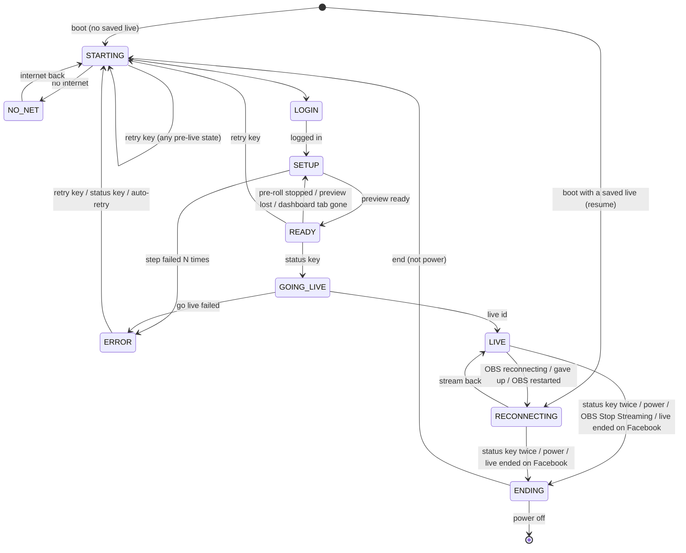

# stream-pilot: states, inputs and what each input does

Every state the stream PC can be in, every input it can get (Stream Deck, power button, OBS, Chromium, Facebook, the system), and what must happen. "Today" is the behavior of image `1ec834d` (read from the code and the journals of the 2026-11-26 in-situ lives); **G-n** marks a gap that this round fixes.

## Controller states

| State | Status key | Meaning |
|---|---|---|
| OFF | dark | PC off or booting before stream-pilot starts |
| STARTING | grey `BOOT` | connecting to OBS and Chromium, checking the network, refreshing SSN |
| NO_NET | grey `NO NET` | no internet; retried every `net_retry_s` |
| LOGIN | orange `LOG IN` | Facebook is not logged in; checked every few seconds until it is |
| SETUP | blue `SETUP` | producer page, persistent key into OBS, pre-roll stream, waiting for Facebook's preview |
| READY | green `GO LIVE` | pre-roll streaming, Facebook preview ready, title set; one press goes live |
| GOING_LIVE | blinking blue | Go live clicked once on Facebook; waiting for the live id |
| LIVE | red `LIVE` | live on Facebook; comments column open and captured |
| RECONNECTING | blinking red | live, but OBS's stream is down (OBS retrying, or stream-pilot restarting it) |
| ENDING (end) | red `ENDING` / `OUTRO n` | outro, stream stop, Facebook auto-end, report; then back to setup |
| ENDING (power) | red `ENDING` | as above, then Chromium and OBS closed and the PC powered off |
| ERROR | orange `ERR <step>` | a setup step failed `attempts` times |
| *paused* (any state) | dark yellow `PAUSED` + state | see "Pause" below: the state is kept, stream-pilot changes nothing by itself |

Retry from SETUP, LOGIN, NO_NET or ERROR also goes to STARTING. Power from any non-live state goes to ENDING (power).

## Inputs and required behavior

Columns: **Pre-live** = STARTING, NO_NET, LOGIN, SETUP. "ignored" means nothing changes and nothing breaks.

### Stream Deck (Mini, 6 keys: top `status` `AF` `MAIN CAM`, bottom `RETRY` `spare` `JEWEL CAM`)

| Input | Pre-live | READY | GOING_LIVE | LIVE / RECONNECTING | ENDING | ERROR |
|---|---|---|---|---|---|---|
| Status key, short press | ignored | go live | **G-1** today ignored → first press arms `PRESS AGAIN` (5 s); second press: end as soon as the live is confirmed | **G-1** today ignored → first press arms `PRESS AGAIN` (5 s, blinking); second press within 5 s ends the live (outro if LIVE) and returns to setup | ignored | retry |
| Status key, held 3 s | ignored | ignored | **G-1** as a short press | **G-1** today ends on release with no feedback → counts as a press (arm / end) | ignored | retry |
| `RETRY` held 3 s | pause (the key counts down `PAUSE 3, 2, 1` from 0.5 s; fires while still held) | ← | ← | ← | ← | ← |
| `RETRY` while paused | resume (short press), as does holding it again | ← | ← | ← | ← | ← |
| `RETRY` | restart setup at once (key shows `BOOT` immediately) | restart setup | **G-2** today silently ignored → ignored, key flashes `BUSY` 2 s | **G-2** today silently ignored → ignored, key flashes `BUSY` 2 s | **G-2** ignored, `BUSY` | restart setup |
| `MAIN CAM` / `JEWEL CAM` | camera to the preview if the holding card is on air, else on air; autofocus on | same | same (preview) | camera on air, autofocus on | **G-3** today switches (cuts the outro) → ignored | as pre-live |
| ...when the configured scene name does not exist in OBS | **G-4** today every press fails silently (the 2026-11-26 "Jewlery Camera" vs OBS "Jewelry Camera") → names resolved against OBS's scene list (exact, then case/space-insensitive, then a unique near match), one clear warning; a press that still fails flashes `NO SCENE` on the key | ← | ← | ← | | ← |
| `AF` | toggle AF ON / MACRO on the active camera | ← | ← | ← | ← | ← |
| spare | warnings only (`MIC?` `CAM?` `NET` `MEM`); press ignored | ← | ← | ← | ← | ← |
| Deck unplugged / replugged | reconnects every 5 s and redraws every key | ← | ← | ← | ← | ← |
| Camera key highlight | **G-5** today only updated by deck presses → follows OBS's program scene (CurrentProgramSceneChanged), also when the host changes scenes in OBS | ← | ← | ← | ← | ← |

### Power button (short press; holding it ~4 s is the firmware's hard cut)

| Pre-live | READY | GOING_LIVE | LIVE / RECONNECTING | ENDING (end) | ENDING (power) | ERROR |
|---|---|---|---|---|---|---|
| close Chromium, stop OBS, power off | same | **G-6** today cancels the go-live mid-click and powers off (a live that just started is left to Facebook's auto-end, no report) → wait for the go-live result, then the live end flow (outro, report) and power off | end flow (outro if LIVE), then power off | power off after the end | ignored | close, power off |

The power guard powers off 15 s after a press unless `status.json` says ENDING, then allows 90 s more.

### Command line

| Input | Behavior |
|---|---|
| `stream-pilot press` | as one short status-key press (so twice in 5 s ends a live) |
| `stream-pilot press --long` | ends a live at once (automation, tests); otherwise ignored |
| `stream-pilot retry` | as the `RETRY` key |
| `stream-pilot pause` (also the "Stream Deck: pause / resume" launcher) | toggles pause |
| `stream-pilot key af\|main\|jewelry` | as the AF, MAIN CAM and JEWEL CAM keys; every key has a "Stream Deck: ..." application-menu entry |

### OBS

| Input | Pre-live | READY | GOING_LIVE | LIVE | RECONNECTING | ENDING |
|---|---|---|---|---|---|---|
| Host clicks Start Streaming | ignored (no live without Go live; the next setup replaces it) | already streaming | — | — | OBS retries itself | ignored |
| Host clicks Stop Streaming | ignored | setup again (new pre-roll) | **G-7** → end once the live is confirmed | **G-7** today taken for a dropped connection: stream-pilot restarted the stream until the power button (2026-11-26 11:36) → ends the live (no outro: the stream already stopped), back to setup | treated as OBS giving up (OBS's events cannot tell a host's stop from its own after RECONNECTING): restart; end with two presses | stream-pilot's own stop |
| Network drop (OBS reconnecting) | — | Facebook preview lost → setup | — | `RECONNECTING`, `NET` warning | — | — |
| OBS reconnected | — | — | — | — | `LIVE` | — |
| OBS gives up reconnecting | — | setup again | — | restart the stream with the same key every `reconnect_retry_s` | ← | — |
| OBS window closed by the host / OBS exits 0 | **G-8** today not restarted (`Restart=on-failure`) → `Restart=always`; setup continues when it is back | **G-8** → back after 3 s; pre-roll gone → setup | **G-8** | **G-8** today the live dies with OBS → OBS back in 3 s, `RECONNECTING`, stream restarted with the same key | ← | stop is the goal; fine |
| OBS crashes | restarted after 3 s (as above) | ← | ← | ← | ← | ← |
| Host changes scene or preview | allowed; deck highlight follows (G-5) | allowed (Studio Mode: preview) | ← | allowed | ← | the outro is on air; a change cuts it |
| Host toggles Studio Mode | allowed; READY re-applies it at the next setup | allowed | — | camera keys still set the **program** (G-9: verified on the PC) | ← | — |
| Host renames / deletes a camera scene | names resolved again on every OBS connect and scene rename (G-4) | ← | ← | ← | ← | ← |

### Chromium and Facebook

| Input | Pre-live | READY | LIVE / RECONNECTING | ENDING |
|---|---|---|---|---|
| Host opens a new tab or window | **G-10** today the layout script forces every Chromium window into the right column under the always-on-top comments column (and stops it maximizing), and setup uses "the first ordinary tab" (could take the host's tab) → the host's windows and tabs are never moved, covered, adopted or navigated: stream-pilot uses only its own tab (tracked by its CDP target id) | ← | ← | ← |
| Host closes stream-pilot's Facebook tab | **G-10** → setup opens a new one | **G-10** today stays green with no producer page (Go live then fails) → setup again | not needed while live (it is parked); setup after the end opens a new one | — |
| Host closes SSN's background or helper tab | **G-15** today stays closed (SSN stops relaying; 2026-11-26 while paused) → reopened on the next Tick (every 15 s, unless paused) and on resume; open tabs are never touched | ← | ← | — |
| Host closes the comments column | — | — | re-opened within a tick (capture re-attach) | — |
| Host closes every Chromium window / Chromium exits 0 | **G-8** today not restarted → `Restart=always` | ← | ← column re-opened after the restart | power steps stop it on purpose |
| Chromium crashes | restarted (3 s), reconnect | ← | ← | — |
| Downloads | **G-11** today Playwright's CDP attach switches downloads to "allowAndName" into a temp dir (random names, no "Show in folder", not openable) → Chromium's own behavior (~/Downloads, real names) restored after every attach | ← | ← | ← |
| Facebook logged out | LOGIN waits | at the next setup | no effect until the end | — |
| Facebook preview lost | — | setup again | — | — |
| Comments column stops getting live updates | — | — | fresh check every 90 s when quiet, reload if it missed comments | — |
| The live is ended on Facebook (phone, Facebook itself) | — | — | **G-12** today OBS is disconnected and retries forever (`RECONNECTING`; seen on the PC) → after 20 s of RECONNECTING, every 30 s: the column, else a fresh copy of the dashboard in a background tab (the column can be stale: it still offered "End live video" minutes after the end) is checked for "Your live video has ended" / "Live video ended" → end flow without outro, back to setup | — |

### System

| Input | Behavior |
|---|---|
| Internet down | pre-live: NO_NET until it is back; READY: preview lost → setup → NO_NET; LIVE: OBS reconnects (`RECONNECTING`, `NET`) |
| KVM display drops / returns, Dell monitor only | display mirror keeps the KVM as the source; the layout script fits OBS and the column to whatever screen is active |
| On-screen keyboard | **G-13** when the KVM drops, the mirrored desktop briefly has no screen (plasma-keyboard logs "There are no outputs - creating placeholder screen", seen during the 2026-11-26 lives) and plasma-keyboard 6.8.3 keeps that stale size (upstream fix plasma-keyboard!192) → the display-mirror service restarts the keyboard after every screen change, once it is closed (KWin restarts the input method when `[Wayland] InputMethod` is cleared and set again; killing it is not restarted) |
| Camera unplugged | `CAM?` within 10 s; the scene shows nothing until it is back |
| Microphone unplugged | `MIC?` after 30 s of silence; the recorder starts a new session when it is back |
| stream-pilot crash / restart | systemd restarts it in 2 s; a saved live resumes (`RECONNECTING` → `LIVE`), otherwise setup starts over |
| Reboot or power cut while live | the stream stops, Facebook ends the live; at boot the saved live is found but OBS is not streaming → setup |
| Memory low | `MEM` on the spare key |
| ERROR | **G-14** today waits for a key press forever → also retried automatically every 2 minutes (the key stays `ERR <step>` meanwhile) |

## Pause (requested 2026-11-26)

"Maintenance" means stream-pilot must stop fighting the host while she gets the stream going by hand or changes configuration, and then come back to a known state.

| | While paused |
|---|---|
| Enter / leave | hold `RETRY` 3 s, or `stream-pilot pause` / the launcher entry; leave the same way or with a short `RETRY` press |
| Kept | the state (even LIVE), comment capture, recording, diagnostics, memory guard, deck warnings |
| Stopped | setup (a running setup is cancelled at once), ERROR auto-retry, READY's pre-roll and preview checks, the OBS restart loop, ending a live whose stream stopped, column re-attach and stale-column reloads, the layout script (unloaded) |
| Still works (the host's own actions) | Go live, two presses to end, power button, camera and AF keys, `RETRY`-free CLI commands |
| OBS events | only followed (LIVE ⇄ RECONNECTING); nothing restarted or ended |
| stream-pilot restart | stays paused (marker in `$XDG_RUNTIME_DIR/stream-pilot/paused`); boot does no setup |
| Reboot | always unpaused |
| Resume | layout script loaded again (KWin reconfigure, which also re-fits OBS and the column); setup states and ERROR: setup from the start; LIVE whose stream is no longer running: ended without outro, then setup; READY and a running LIVE: the next Tick's checks |

## Host changes win

Outside pause, too, stream-pilot does not undo what the host does on purpose: Stop Streaming in OBS ends a live (G-7); scene and preview changes stand; her Chromium windows and tabs are never touched (G-10); a window she moved or resized is only fitted again when it no longer fits the screen (after a display change). The one thing still re-done is a stopped pre-roll in READY (Facebook refusing the key looks the same); pause it first.

## Layout (requested 2026-11-26)

The comments column on the left (30 % of the work area, at least its minimum width), OBS on the right (70 %). The column is no longer always on top and shows in the taskbar, so the host can bring her own Chromium window forward and click the column (or the taskbar) to get it back. stream-pilot's own Chromium window gets the column's place once when it first opens; every other Chromium window is left where the host puts it.
